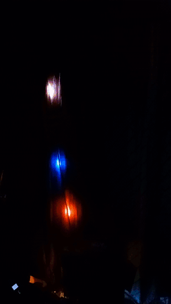
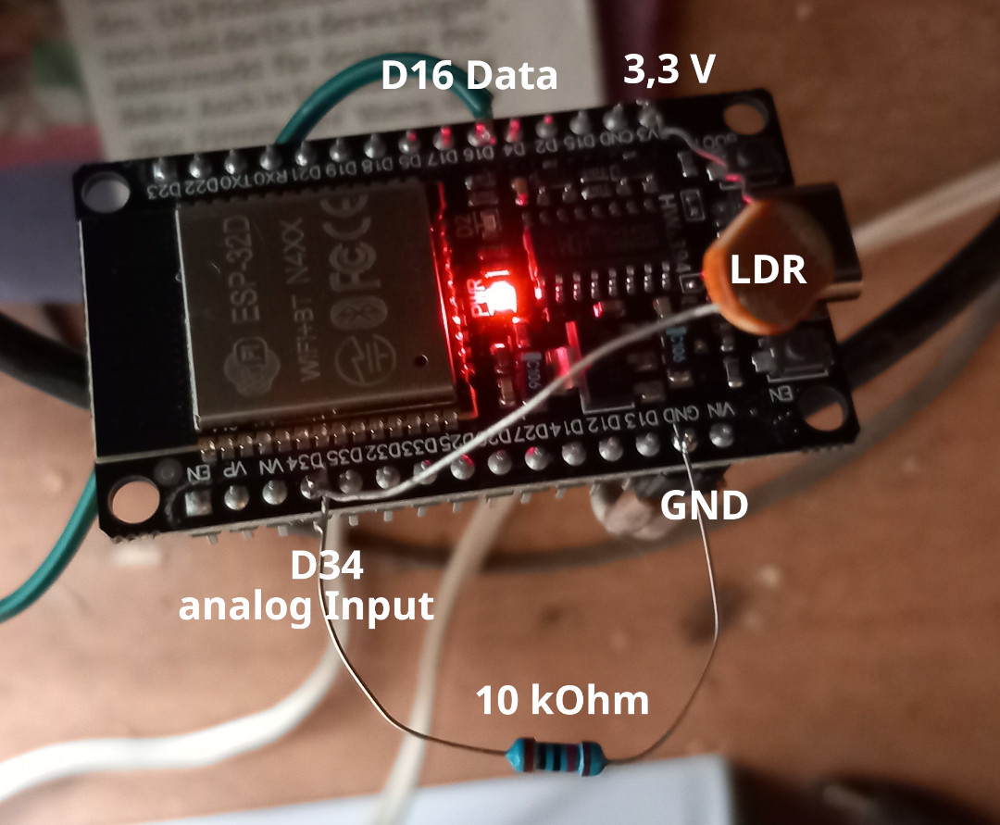

# W2812B_ESP32_Weihnachtsbaum
Eine Weihnachtsbaumbeleuchtung mit einer LED-Strippe W2812B, einem ESP32 und einem Helligkeitssensor.
Die Geschwindigkeit des Lauflichts lässt sich für jede Farbe einstellen.

Ich habe eine 5 Meter lange LED-Strippe (5 Volt) mit 60 LEDs/Meter = 300 LEDs genommen. Erstaunlicherweise reicht ein Handy-Ladegerät um den ESP32 und die LEDs zum laufen zu bringen. Würden alle LEDs hell leuchten, bräuchte man ein Netzteil, welches 60 Watt liefert.
